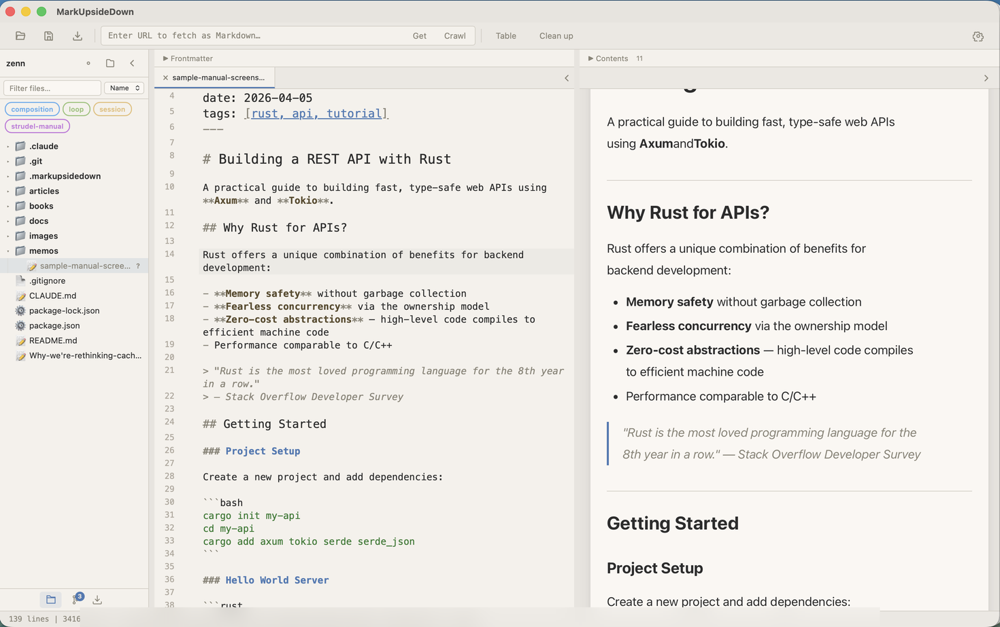
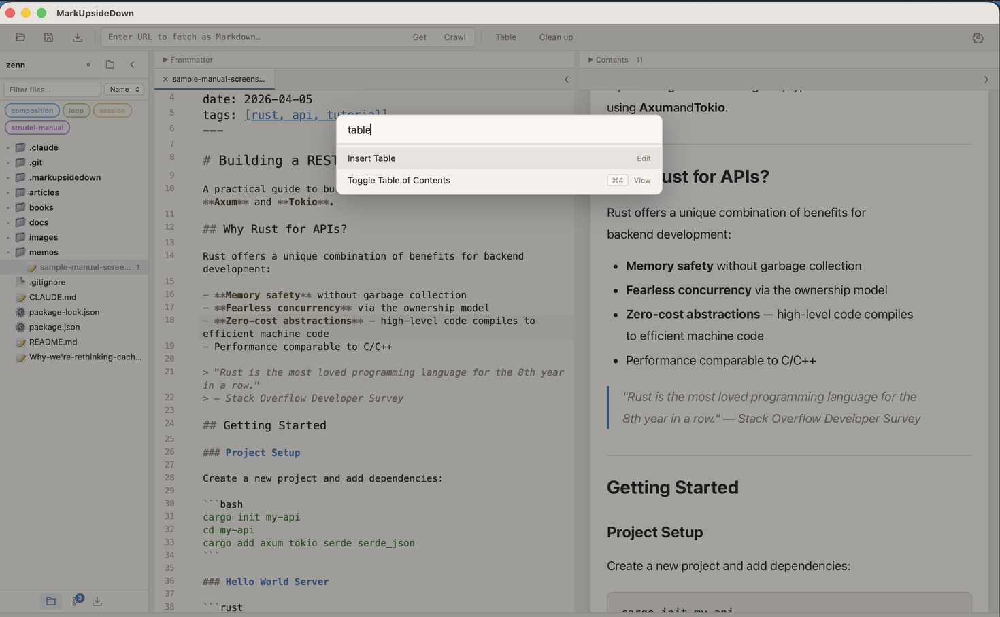
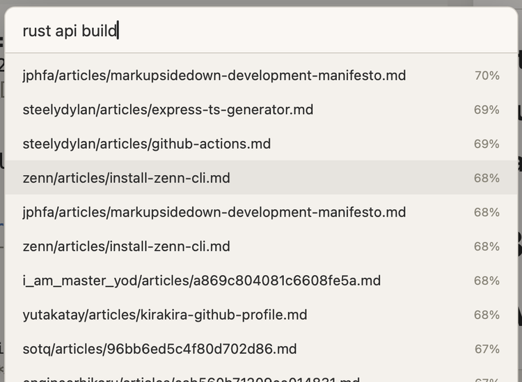

# Editor Basics

MarkUpsideDown uses a split-pane layout: the editor on the left, the live preview on the right, and an optional sidebar for file browsing. This chapter covers the editor pane and the tools around it.

## The Toolbar

The toolbar is also the window's title bar: drag empty space to move the window, and double-click it to zoom. Its buttons follow the order you work in, from bringing content in, to shaping it, to sending it out:

| Button | Action |
|--------|--------|
| **Sidebar** (left edge) | Show or hide the sidebar (Cmd+1) |
| **URL field** and **Get** | Fetch a web page as Markdown (see below) |
| **Import** | Import a document (PDF, DOCX, etc.), open a file or folder, or clone a repository |
| **Table** | Open the table editor |
| **Clean up** | Normalize the document (headings, tables, whitespace, CJK emphasis spacing) |
| **Copy** | Copy the document as rich text or as Markdown |
| **Publish** | Publish the current file to a shareable URL (see [Publishing](publishing.md)) |
| **Present** | Show the document as slides (see [Presentation Mode](presentation.md)) |
| **Command** (⌘ icon) | Open the command palette (Cmd+K) |
| **Settings** (gear icon) | Open the settings dialog |

In narrow windows the buttons show only their icons; hover over one to see its name.

Open and Save are in the **File** menu: **Open…** (Cmd+O), **Open Folder…** (Cmd+Shift+O), **Save** (Cmd+S), and **Import Document…** (Cmd+Shift+I).

## The URL Field

Type or paste a URL into the field in the toolbar, then press **Enter** or click **Get** to fetch the page and convert it to Markdown. The arrow next to **Get** offers other ways to fetch the same URL:

- **Fetch Static Page**: convert the HTML as served, without running JavaScript
- **Render with Browser**: render JavaScript-heavy pages first (needs a Worker with Browser Run)
- **Crawl Site…**: open the crawl dialog for multi-page crawling

See [Importing Content](importing-content.md) and [Crawling Websites](crawling-websites.md) for details.

## Writing Markdown

The editor is built on CodeMirror 6 and provides:

- **Syntax highlighting** for Markdown elements (headings, links, code, etc.)
- **Line numbers** in the gutter (off by default; turn them on in **Settings → Appearance**)
- **Active line highlighting**
- **Search & replace** (Cmd+F)
- **Bracket matching**

### Formatting Shortcuts

Select text and use these shortcuts to apply formatting:

| Shortcut | Result |
|----------|--------|
| Cmd+B | **Bold** (`**text**`) |
| Cmd+I | *Italic* (`*text*`) |
| Cmd+Shift+X | ~~Strikethrough~~ (`~~text~~`) |
| Cmd+\` | `Inline code` (`` `text` ``) |

If no text is selected, the shortcut inserts the formatting markers and places the cursor between them.

## Command Palette

Press **Cmd+K** to open the command palette. Start typing to fuzzy-search through all available commands. Each command shows its keyboard shortcut (if any) on the right.

### Semantic Search in the Command Palette

Type `?` followed by your query to switch to semantic search mode. Instead of matching command names, this searches your indexed documents by meaning and shows results with relevance percentages.

## Panel Layout

Control which panes are visible:

| Shortcut | Panel |
|----------|-------|
| Cmd+1 | Toggle sidebar |
| Cmd+2 | Toggle editor pane |
| Cmd+3 | Toggle preview pane |
| Cmd+4 | Toggle Table of Contents |
| Cmd+5 | Open Semantic Search |

You can drag the divider between the editor and preview to adjust the split ratio (from 20/80 to 80/20).

## Tabs

MarkUpsideDown supports multi-tab editing:

- Open multiple files and switch between them with tabs
- **Cmd+Shift+[** and **Cmd+Shift+]** to switch tabs
- **Cmd+W** to close the current tab
- Drag tabs to reorder them
- Tab state is persisted across sessions

## Status Bar

The left side of the status bar shows short messages, such as "Document cleaned up" or crawl progress. They clear after a few seconds.

The right side shows the state of the current document. Each item is a button:

- **Branch** (in a Git repository), with arrows for commits ahead of or behind the remote. Click to open the Changes panel.
- **Published**, when the current file is published. Click to copy its public URL.
- **Word count**. Click to switch to the character count.
- **Worker**, with a dot for the Cloudflare Worker's state: green when connected, amber when it needs an update, red when it cannot be reached, and hollow when no Worker is set up. Click to open Settings.

Hover over a tab to see the file's full path.

## Appearance

**Settings → Appearance** sets the reading font (Sans or Serif) and size (Small, Medium, or Large) for the preview and presentation mode, and whether the editor shows line numbers. Changes apply immediately in every window.

## Saving

- **Cmd+S** saves the current file
- **Auto-save** (optional, enabled in Settings) saves automatically after a brief pause in typing
- If a file is changed externally (e.g., by another editor or an AI agent), MarkUpsideDown detects the change and reloads the content automatically

## Multi-Window

You can open multiple windows, each with its own set of tabs and state. Windows are restored when you relaunch the app.

See [Keyboard Shortcuts](keyboard-shortcuts.md) for the complete shortcut reference.
