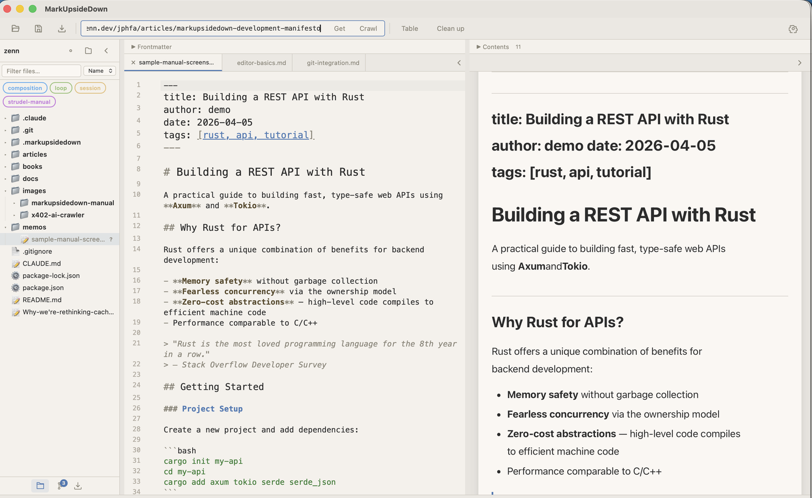
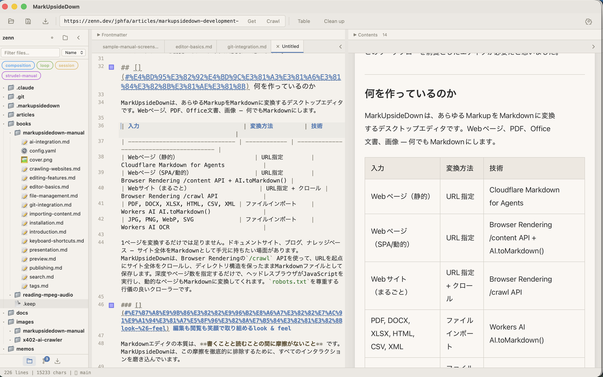

# Importing Content

MarkUpsideDown can convert a wide range of content into Markdown: web pages, documents, and images. All conversions are powered by Cloudflare Workers AI.

## Fetching Web Pages

### Static Pages (Get)

Type a URL into the URL bar and click **Get**. The page is fetched and converted to Markdown using Cloudflare's Markdown for Agents / `AI.toMarkdown()`.

This works well for most web pages — articles, documentation, blog posts. Relative links and images are resolved to absolute URLs, so they keep working in the saved file.

### JavaScript-Rendered Pages (Render)

For pages that rely on JavaScript to render content (SPAs, dynamic sites), use the **Render** option. This uses Cloudflare Browser Run to load the page in a headless browser, wait for JavaScript to execute, then convert the rendered page to Markdown.

Rendering works right after the Worker is deployed and needs no API token. Cloudflare caches rendered results for 1 hour, so rendering the same URL again within that time is fast and uses no browser time.

### Auto Link Title

When you paste a URL into the editor, MarkUpsideDown automatically fetches the page title and formats it as a Markdown link: `[Page Title](https://example.com)`. This saves you from manually looking up titles.

### Link Context Menu

Right-click any link in the preview pane to get a context menu with quick actions:

- **Fetch** — convert the linked page to Markdown
- **Render** — render with JavaScript and convert
- **Crawl** — start crawling from that URL

## Importing Files

Choose **Import → Import Document…** in the toolbar, or **File → Import Document…** (Cmd+Shift+I), to open a file picker. Select a document to convert it to Markdown.

### Supported Formats

| Format | Extension |
|--------|-----------|
| PDF | `.pdf` |
| Word | `.docx` |
| Excel | `.xlsx` |
| HTML | `.html`, `.htm` |
| CSV | `.csv` |
| XML | `.xml` |
| Images (OCR) | `.jpg`, `.png`, `.webp`, `.svg`, `.gif`, `.bmp` |

You can also **drag and drop** supported files onto the editor to import them.

### How It Works

Files are sent to your Cloudflare Worker, which uses `AI.toMarkdown()` to convert them. For images, OCR is performed to extract text. For PDFs, the document metadata block (producer, PDF version, and so on) is left out of the result.

## Batch Import

For converting multiple files at once, MarkUpsideDown supports batch import:

1. Select multiple supported files in the sidebar
2. Right-click and choose **Batch Convert N Files…**
3. The app converts the files through your Worker, 4 at a time, and saves each result as a `.md` file in the project root
4. When it finishes, a summary shows how many files were converted and lists any that failed

Batch import needs only the Worker URL.
