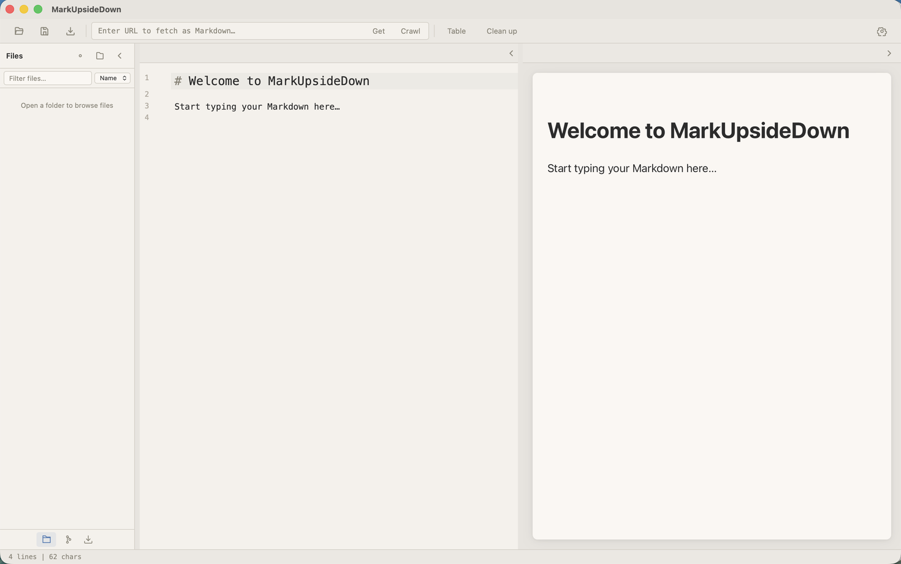
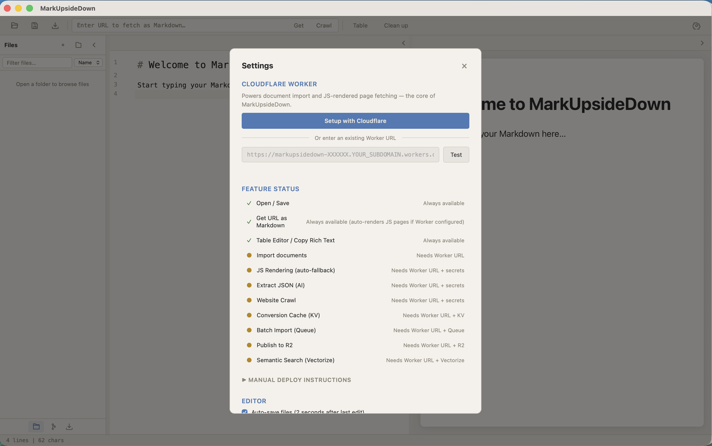
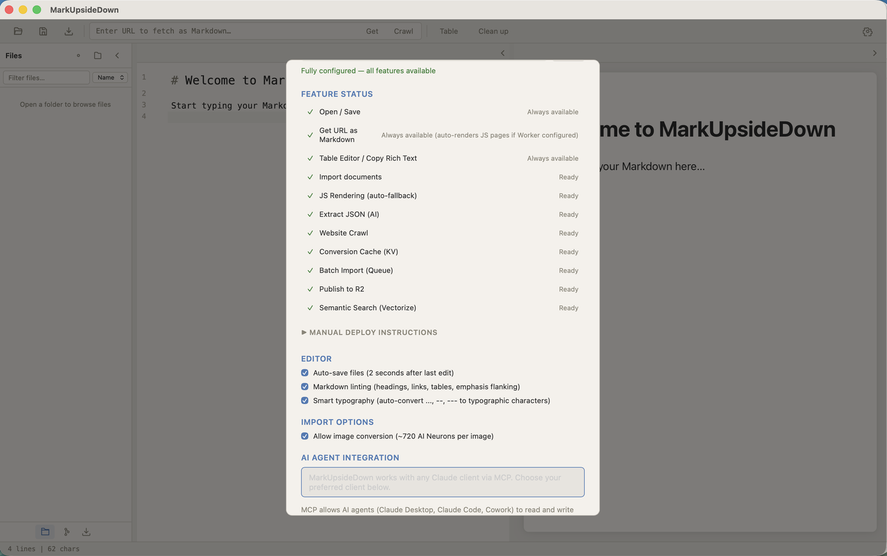

# Installation & Setup

## Installing MarkUpsideDown

### Homebrew (Recommended)

The easiest way to install on macOS:

```bash
brew install M-Igashi/tap/markupsidedown
```

### GitHub Releases

Download the latest `.dmg` from the [Releases page](https://github.com/M-Igashi/MarkUpsideDown/releases). Open the `.dmg` and drag MarkUpsideDown to your Applications folder.

The app is signed and notarized by Apple, so it opens without Gatekeeper warnings either way.

## System Requirements

- **macOS** on Apple Silicon (M1/M2/M3/M4)

## First Launch

When you open MarkUpsideDown for the first time, you'll see an empty editor. The app works immediately for local Markdown editing — no setup required for basic use.



To unlock conversion features (importing documents, fetching URLs, crawling websites), you need to set up a Cloudflare Worker.

## Cloudflare Worker Setup

Click **Settings** in the toolbar to open the Settings dialog.



### Auto Setup (Recommended)

Click **"Setup with Cloudflare"** to start the automated setup wizard. It walks through 7 steps:


| Step | What it does |
|------|-------------|
| 1. Check wrangler | Verifies that `wrangler` CLI is installed (`npm install -g wrangler`) |
| 2. Cloudflare login | Opens your browser for Cloudflare OAuth (skipped if already logged in) |
| 3. Create R2 bucket | Creates the R2 bucket used for publishing (semantic search needs no setup: its AI Search instance is created on first use) |
| 4. Deploy Worker | Deploys the Worker with a randomized URL (e.g., `markupsidedown-a3f8k2.workers.dev`) |
| 5. Protect Worker with API key | Sets a random `API_KEY` Worker secret and saves it in the app |
| 6. Configure crawl secrets (optional) | Asks for an API token (**Account > Browser Run > Edit** and **Account > Workers AI > Read**) and sets `CLOUDFLARE_ACCOUNT_ID` and `CLOUDFLARE_API_TOKEN` as Worker secrets (only needed for Website Crawl) |
| 7. Verify | Tests the deployed Worker and confirms which features are available |


Each step shows its status: pending (○), running (●), done (✓), error (✗), or skipped (—).


> **Step 6 is optional:** Paste an API token created at [dash.cloudflare.com/profile/api-tokens](https://dash.cloudflare.com/profile/api-tokens), or click "Skip for now". Every feature except Website Crawl works without it, and you can add the secrets later.

### Manual Setup

If you already have a deployed Worker, you can connect it manually:

1. In Settings, paste your Worker URL (e.g. `https://markupsidedown-XXXXXX.workers.dev`)
2. Click **Test** to verify the connection
3. Click **Save**

For full manual deployment instructions (including CLI commands), see [Worker Deployment Guide](../worker-deployment.md#manual-setup).

### Testing the Connection

After setup, the **Test** button sends a health check to your Worker and reports which features are available.

### Feature Status

The Feature Status section shows a green checkmark or amber dot for each capability:



| Feature | Requires |
|---------|----------|
| Open / Save | Nothing (always works) |
| Get URL as Markdown | Nothing (always works) |
| Table Editor / Copy Rich Text | Nothing (always works) |
| Import documents | Worker URL |
| JS Rendering | Worker URL |
| Extract JSON (AI) | Worker URL |
| Website Crawl | Worker URL + secrets |
| Publish to R2 | R2 bucket |
| Semantic Search (AI Search) | Worker URL |

Features that show an amber dot are available once their requirements are met. The auto setup creates everything needed, so all features should show green after a successful setup. If JS Rendering, Extract JSON, or Semantic Search shows "Needs Worker update", click **Update Worker**.

## Editor Settings

In Settings → Editor:

| Setting | Default | Description |
|---------|---------|-------------|
| **Auto-save files** | Off | Saves automatically 2 seconds after last edit |
| **Markdown linting** | Off | Shows structural issues in the editor gutter |
| **Smart typography** | Off | Auto-converts `...` → `…`, `--` → `–`, `---` → `—` |

## Import Options

In Settings → Import Options:

| Setting | Default | Description |
|---------|---------|-------------|
| **Allow image conversion** | Off | Enables OCR-based image import (~720 AI Neurons per image) |

## Updating the Worker

When a new version of MarkUpsideDown includes Worker updates, an **"Update Worker"** button appears in Settings. Click it to re-deploy with the latest code — no need to re-run the full setup.
