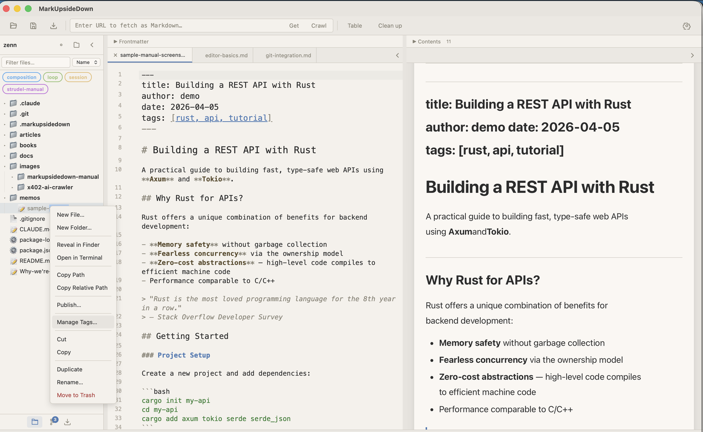

# Publishing

MarkUpsideDown can publish Markdown files to Cloudflare R2, giving you shareable URLs for your content.

## Requirements

Publishing requires the **PUBLISH_BUCKET** R2 binding in your Cloudflare Worker. This is set up automatically during the Cloudflare Worker setup (see [Installation & Setup](installation.md)). Check **Settings → Feature Status** to confirm "Publish to R2" shows a green checkmark.

## How to Publish

Open the Markdown file, then click **Publish** in the toolbar. Or right-click the file in the sidebar and choose **Publish…**. Then choose an expiry:
- **Publish as Permanent Link**: no expiration
- **Publish for 1 Hour**
- **Publish for 24 Hours**
- **Publish for 7 Days**

Publishing from the toolbar saves pending edits first. The toolbar button is unavailable until a Worker is set up and the current tab is a saved Markdown file inside the open folder.

The file is uploaded to R2 and you receive a shareable URL. By default, the URL format is `https://your-worker.workers.dev/p/:key`. If [R2 public access](../worker-deployment.md#r2-public-access-for-published-urls-optional) is configured, URLs use the R2 public domain instead (e.g. `https://pub-abc123.r2.dev/:key`), keeping the Worker URL secret.

## Published File Indicator

Published files show an indicator in the sidebar, so you can see at a glance which files have been shared. When the current file is published, the toolbar's **Publish** button shows a dot and the status bar shows **Published** (click it to copy the URL).

## Updating a Published File

Publishing uploads a snapshot. After you edit and save the file, choose **Update Published Version** from the toolbar's **Publish** menu or the file's context menu to replace the content at the same URL. A time-limited link keeps its original expiry time. Unsaved changes in the editor are not included.

## Unpublishing

To remove a published file, choose **Unpublish** from the toolbar's **Publish** menu or the file's context menu. The content is deleted from R2 and the URL stops working.

## How It Works

- Content is stored in a Cloudflare R2 bucket (object storage)
- Published files are served as `text/markdown` at the `/p/:key` endpoint
- Time-limited URLs automatically expire — the content is removed when the time is up
- No authentication is required to view published files (anyone with the URL can access them)

> **Note:** The key in a published URL is derived from the file's path (for example `/p/notes/meeting`), so treat the URL as unlisted rather than secret. It is not password-protected: anyone with the URL can read the content. Don't publish sensitive content.
>
> **Note:** If using R2 public access, a time-limited URL can stay accessible for up to 15 minutes after it expires. The Worker's `/p/:key` endpoint enforces expiration immediately, while the R2 public URL serves the object until the Worker's scheduled cleanup (every 15 minutes) deletes it.
