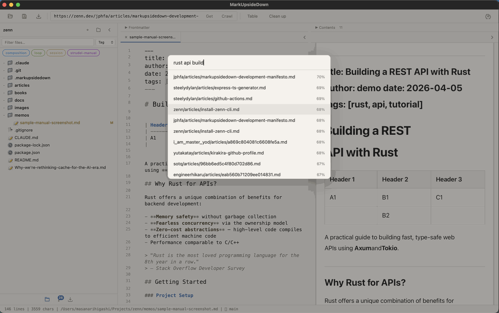
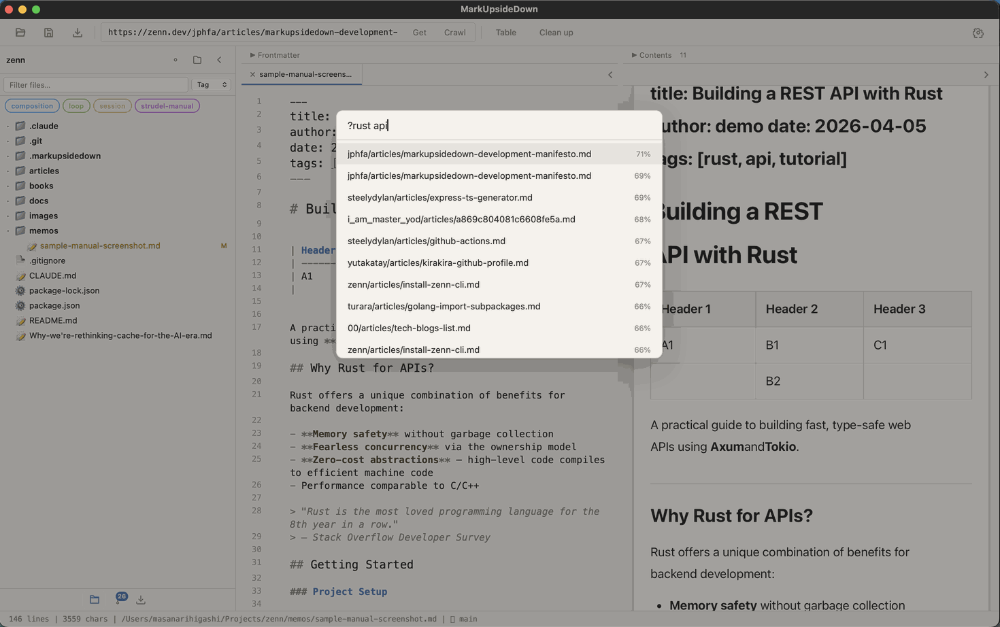

# Semantic Search

Semantic search lets you find documents by meaning, not only by exact keywords. It is powered by Cloudflare AI Search, which combines vector embeddings with keyword matching (hybrid search). The embedding model is multilingual, and keyword matching also works for Chinese, Japanese, and Korean text.

## Requirements

Semantic search requires the **AI_SEARCH** binding in your Cloudflare Worker (Worker v13 or later). It is included when the Worker is deployed (see [Installation & Setup](installation.md)), and there is nothing else to set up: the search instance is created automatically the first time a document is indexed. Check **Settings → Feature Status** to confirm "Semantic Search (AI Search)" shows a green checkmark. If it says "Needs Worker update", click **Update Worker**.

## Indexing Documents

Documents are indexed automatically when they are imported or crawled. You can also manually index documents through the MCP server's `index_documents` tool.

Indexing uploads your document content to Cloudflare AI Search, which splits it into chunks and indexes them for both vector and keyword search. Indexing finishes in the background, so a newly indexed document can take a short while to appear in results. Indexing a document again replaces its previous content.

Documents indexed with an older Worker (before v13) are not carried over. They are indexed again the next time you import, convert, or crawl them.

## Searching

There are two ways to search:

### Dedicated Search Panel (Cmd+5)

Press **Cmd+5** to open the semantic search panel. Type your query and results appear with relevance scores. Each document appears once, ranked by its best-matching passage.

### Command Palette (? prefix)

Open the command palette (Cmd+K) and type `?` followed by your query. Results show document matches with relevance percentages instead of commands.

## Working with Results

- Results are ranked by relevance (shown as a percentage)
- Use Arrow Up/Down to navigate results
- Press Enter to open the selected document
- Press Escape to close the search

## Removing Documents from the Index

Documents can be removed from the search index through the MCP server's `remove_document` tool, or by calling the Worker's `DELETE /embed/:id` endpoint directly.
